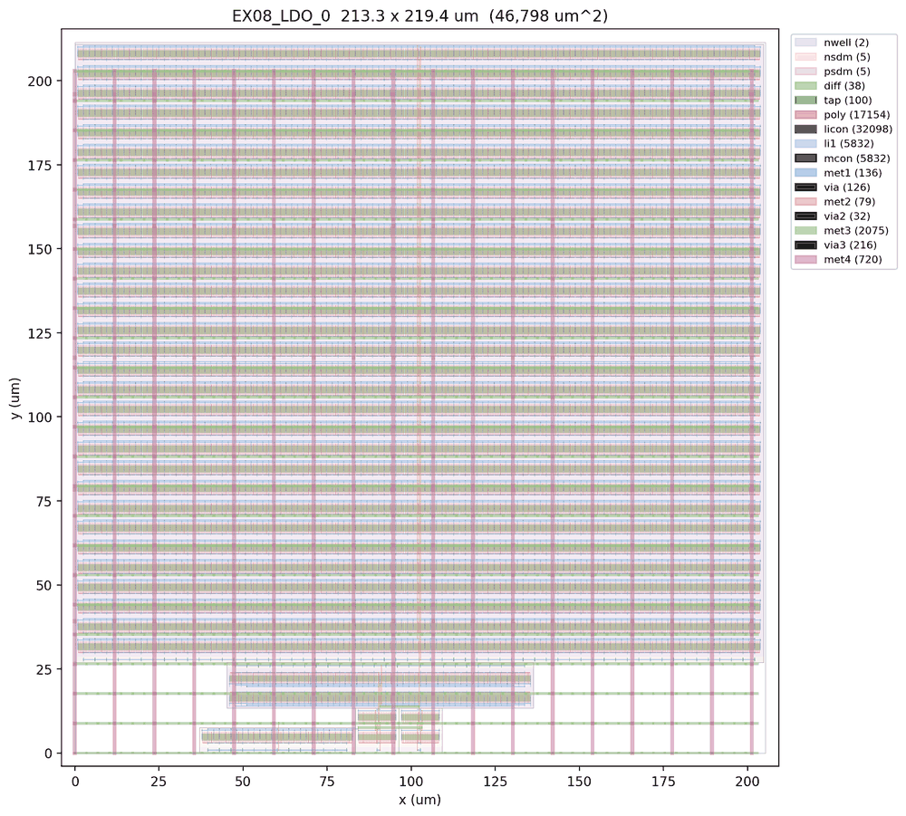
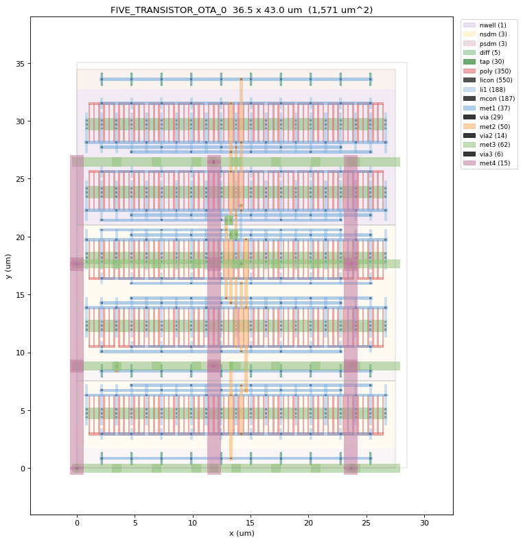
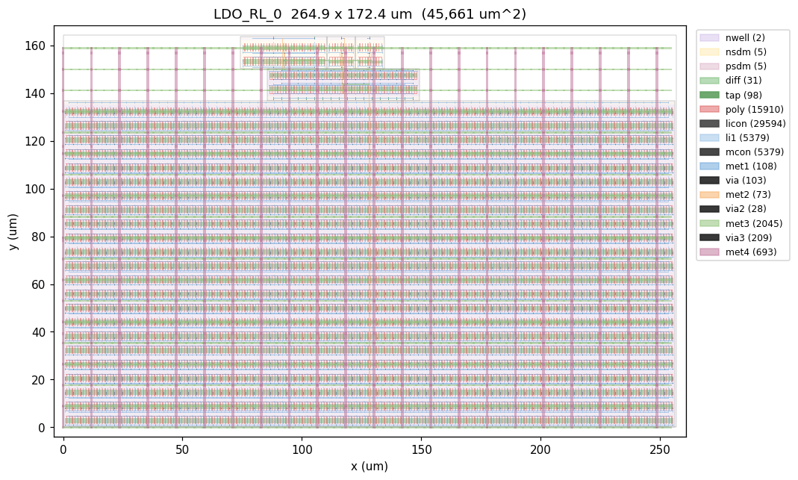

# 처음 하는 사람을 위한 설치 · 실행 매뉴얼

이 문서는 아무것도 깔려 있지 않은 리눅스 계정에서 시작해서 아래 일을 차례로 따라 할 수 있게 쓴 것입니다.
모든 명령은 **복사해서 그대로 붙여 넣으면** 되도록 썼고, 각 단계 끝에 "제대로 됐는지 확인하는 방법"을 붙였습니다.

1. 파이썬 환경 만들기
2. 회로 시뮬레이터 ngspice 설치하기 (관리자 권한 `sudo` 없이도 가능)
3. 강화학습(RL)으로 아날로그 회로 크기 정하기 (sizing)
4. 연습용 RL 예제(ex01–ex08) 돌려 보기
5. RL이 정한 크기로 **레이아웃(GDS)까지 자동으로 그리기** (ALIGN)
6. 레이아웃 기생을 넣고 **post-layout 시뮬레이션으로 9개 PVT 다시 확인하기**

```text
 [RL 학습]  --크기(W, L, C, R)-->  [ngspice 시뮬레이션으로 확인]  --넷리스트-->  [ALIGN 자동 레이아웃]  -->  GDS 파일 / PNG 그림
                                                                                         |
                                                              [post-layout 시뮬레이션] <-- 배선 기생 R/C 추출
  analog_sizing/train.py              eval_engines/ngspice/                       layout/
```

> 이 문서의 모든 명령은 Rocky Linux 10 서버(GPU: RTX 5090 / RTX PRO 6000 Blackwell)에서 실제로 실행해 확인했습니다.
> Ubuntu에서도 같은 명령이 동작합니다. 다른 점은 해당 위치에 따로 적었습니다.

---

## 목차

- [0. 시작 전에 알아 둘 용어](#0-시작-전에-알아-둘-용어)
- [1. 준비물 확인](#1-준비물-확인)
- [2. conda 설치 (이미 있으면 건너뛰기)](#2-conda-설치-이미-있으면-건너뛰기)
- [3. 저장소 받기](#3-저장소-받기)
- [4. 파이썬 환경 만들기](#4-파이썬-환경-만들기)
- [5. ngspice 설치](#5-ngspice-설치)
- [6. 설치가 잘 됐는지 확인](#6-설치가-잘-됐는지-확인)
- [7. 회로 크기 학습 돌리기 (HER / SAC)](#7-회로-크기-학습-돌리기-her--sac)
- [8. 연습용 RL 예제 ex01–ex08 와 발표 자료](#8-연습용-rl-예제-ex01ex08-와-발표-자료)
- [9. 레이아웃 자동 생성 (ALIGN)](#9-레이아웃-자동-생성-align)
- [10. 자주 나는 에러와 해결법](#10-자주-나는-에러와-해결법)

---

## 0. 시작 전에 알아 둘 용어

| 용어 | 뜻 |
|---|---|
| **터미널** | 명령을 글자로 입력하는 검은 창. 이 문서의 회색 상자 안 명령을 여기에 붙여 넣습니다. |
| **conda** | 파이썬과 라이브러리를 "환경" 단위로 따로따로 설치해 주는 프로그램. 프로젝트끼리 버전이 섞이지 않게 해 줍니다. |
| **환경 (env)** | conda가 만든 독립된 파이썬 설치본. `conda activate 이름` 으로 들어가고 `conda deactivate` 로 나옵니다. |
| **ngspice** | 회로 시뮬레이터. 넷리스트(회로를 글로 적은 파일)를 읽어 전압·전류를 계산합니다. |
| **PDK** | 공정(예: SKY130, GF180)의 트랜지스터 모델과 설계 규칙 묶음. 이 저장소의 `eval_engines/pdk/` 에 시뮬레이션용 모델이 들어 있습니다. |
| **corner** | 공정·전압·온도가 나쁜 쪽으로 흔들린 경우(예: ss, 3.0V, −40°C). 실제 칩은 모든 corner에서 스펙을 지켜야 합니다. |
| **레이아웃 / GDS** | 칩을 실제로 만들 때 쓰는 도면. GDS는 그 도면의 파일 형식입니다. |
| **ALIGN** | 넷리스트를 넣으면 레이아웃(GDS)을 자동으로 그려 주는 오픈소스 도구 (미네소타대 · 텍사스 A&M · Intel). |

---

## 1. 준비물 확인

| 항목 | 필요한 것 | 확인 명령 |
|---|---|---|
| 운영체제 | 64비트 리눅스 (Ubuntu 20.04+, Rocky/RHEL 8+ 등) | `cat /etc/os-release` |
| 디스크 | 약 15GB (파이썬 환경 약 6GB, ALIGN 약 3GB) | `df -h ~` |
| git | 아무 버전 | `git --version` |
| C++ 컴파일러 | gcc 6.1 이상 (**ALIGN을 쓸 때만** 필요) | `gcc --version` |
| GPU | 없어도 됩니다 (CPU로 학습 가능) | `nvidia-smi` |

`git` 이나 `gcc` 가 없으면 관리자에게 설치를 부탁하거나, Ubuntu라면 `sudo apt-get install git build-essential` 을 실행합니다.

---

## 2. conda 설치 (이미 있으면 건너뛰기)

`conda --version` 을 쳤을 때 버전이 나오면 이 단계는 건너뜁니다.

```bash
cd ~
wget https://repo.anaconda.com/miniconda/Miniconda3-latest-Linux-x86_64.sh
bash Miniconda3-latest-Linux-x86_64.sh -b -p $HOME/miniconda3
$HOME/miniconda3/bin/conda init bash
```

**터미널을 닫았다가 다시 엽니다.** 프롬프트 앞에 `(base)` 가 보이면 성공입니다.

```bash
conda --version        # 예: conda 25.7.0
```

---

## 3. 저장소 받기

```bash
cd ~
git clone https://github.com/youngmin0oh/wemeet2026.git
cd wemeet2026
```

이후 모든 명령은 **이 폴더(`~/wemeet2026`)에서** 실행한다고 가정합니다.
(폴더 위치가 다르면 `cd 그폴더` 로 먼저 이동하세요.)

---

## 4. 파이썬 환경 만들기

### 4-1. 환경 만들기 (약 3분)

```bash
conda env create -f environment.yml
conda activate analog_sizing
```

프롬프트 앞이 `(analog_sizing)` 으로 바뀌면 성공입니다. 이 환경에는 다음이 정확한 버전으로 들어갑니다.

| 패키지 | 버전 | 왜 이 버전인가 |
|---|---|---|
| python | 3.9.19 | |
| gymnasium | **0.29.1** | HER 학습은 이 버전이어야 합니다 (1.x 에서는 에러, [10장](#10-자주-나는-에러와-해결법) 참고) |
| stable-baselines3 | 2.3.2 | SAC / HER / PPO 구현 |
| torch | 2.4.0 | 신경망 |

> **앞으로 터미널을 새로 열 때마다** `conda activate analog_sizing` 을 먼저 실행해야 합니다.

### 4-2. (GPU가 RTX 50xx / Blackwell 계열일 때만) torch 바꾸기

`environment.yml` 의 torch 2.4.0 은 RTX 50xx, RTX PRO 6000 Blackwell 같은 최신 GPU를 모릅니다.
이런 GPU에서는 학습을 시작하면 `CUDA error: no kernel image is available for execution on the device` 가 납니다.
아래처럼 CUDA 12.8 용 torch로 바꿔 줍니다.

```bash
nvidia-smi --query-gpu=name,compute_cap --format=csv    # compute_cap 이 12.0 이면 Blackwell
pip install torch==2.7.1 --index-url https://download.pytorch.org/whl/cu128
python -c "import torch; print(torch.__version__, torch.cuda.is_available())"   # 2.7.1+cu128 True
```

GPU가 없거나 이전 세대(RTX 30xx/40xx, A100 등)라면 이 단계는 필요 없습니다.

### 4-3. 연습 예제용 추가 패키지

```bash
pip install tqdm pytest
```

---

## 5. ngspice 설치

ngspice 는 회로를 시뮬레이션하는 프로그램입니다. 학습 중에 매 step 마다 수십 번씩 실행됩니다.
아래 세 방법 중 **하나만** 하면 됩니다. 잘 모르겠으면 **방법 A** 를 쓰세요.

### 방법 A. conda 로 설치 (추천, 관리자 권한 필요 없음, 약 1분)

```bash
conda activate analog_sizing
conda install -y -c conda-forge ngspice
which ngspice          # .../envs/analog_sizing/bin/ngspice 가 나오면 성공
ngspice -v | head -2   # ** ngspice-41 ... (버전은 달라도 됩니다)
```

`analog_sizing` 환경을 켰을 때만 이 ngspice 가 쓰입니다.

### 방법 B. 시스템 패키지로 설치 (관리자 권한 필요)

```bash
# Ubuntu / Debian
sudo apt-get update && sudo apt-get install -y ngspice
# Fedora
sudo dnf install -y ngspice
```

### 방법 C. 소스에서 직접 빌드 (최신 버전이 꼭 필요할 때만)

```bash
cd ~ && wget https://sourceforge.net/projects/ngspice/files/ng-spice-rework/44.2/ngspice-44.2.tar.gz
tar xzf ngspice-44.2.tar.gz && cd ngspice-44.2
./configure --prefix=$HOME/.local --enable-openmp --with-readline=no --disable-debug
make -j8 && make install
echo 'export PATH=$HOME/.local/bin:$PATH' >> ~/.bashrc && source ~/.bashrc
```

### 5-1. 꼭 확인: 스레드 설정 파일 `.spiceinit`

저장소 맨 위 폴더에 `.spiceinit` 파일이 들어 있습니다. 내용은 한 줄입니다.

```text
set num_threads=1
```

**왜 필요한가요?** 이 프로젝트는 corner 16개를 *동시에* 시뮬레이션합니다. 그런데 ngspice 설치본에 따라
"회로 하나를 스레드 여러 개로 나눠 풀기(`num_threads=8` 등)"가 켜져 있으면, 16 × 8 = 128개 스레드가 CPU를 서로 빼앗아
오히려 엄청나게 느려집니다. 실제로 잰 값은 다음과 같습니다 (TSA 회로, 16개 corner 한 번).

| ngspice | `.spiceinit` 없음 | `.spiceinit` 있음 (`num_threads=1`) |
|---|---|---|
| 시스템 ngspice 44.2 (`num_threads=8` 기본) | **179초** | 0.27초 |
| conda ngspice 41 | 0.99초 | 0.27초 |

ngspice 는 **명령을 실행한 폴더의 `.spiceinit`** 을 읽습니다. 그래서 학습·시뮬레이션은 항상 **저장소 맨 위 폴더에서** 실행하세요.
다른 폴더에서 실행해야 한다면 `cp .spiceinit ~/` 로 홈 폴더에도 복사해 두면 됩니다.

---

## 6. 설치가 잘 됐는지 확인

```bash
conda activate analog_sizing
cd ~/wemeet2026
python scripts/random_rollout.py --env TSA --episodes 1 --steps 2 --seed 0
```

화면 맨 끝이 아래와 **똑같이** 나오면 파이썬 환경과 ngspice 가 모두 제대로 된 것입니다.

```text
Episode 1 finished: step limit reached; steps=2; return=-8.166371
```

자동 테스트도 돌려 봅니다.

```bash
python -m pytest -q tests          # 25 passed 가 나오면 성공
```

---

## 7. 회로 크기 학습 돌리기 (HER / SAC)

### 7-1. 들어 있는 회로

| 이름 | 회로 | 공정 | 실행 스크립트 | 학습 길이 |
|---|---|---|---|---|
| TSA | 2단 증폭기 (two-stage op-amp) | GF180 | `scripts/TSA.sh` | 12000 step |
| CMA | 캐스코드 밀러 증폭기 | GF180 | `scripts/CMA.sh` | 24000 step |
| LDO | 저전압 강하 레귤레이터 | SKY130 | `scripts/LDO.sh` | 12000 step |
| COMP | 비교기 | GF180 | `scripts/COMP.sh` | 8000 step |

### 7-2. 실행

```bash
conda activate analog_sizing
cd ~/wemeet2026
bash scripts/TSA.sh                          # 기본: HER
bash scripts/TSA.sh --algo SAC --seed 42     # 옵션을 뒤에 붙이면 덮어씁니다
```

GPU가 여러 개면 `CUDA_VISIBLE_DEVICES=1 bash scripts/TSA.sh` 처럼 쓸 GPU를 고를 수 있습니다.
터미널을 닫아도 계속 돌게 하려면 `nohup bash scripts/TSA.sh > tsa.log 2>&1 &` 로 실행합니다.

**TT 만 보는 환경 (PVT corner 없이)**

기본 환경은 공정·전압·온도(PVT)를 바꾼 여러 corner(TSA·CMA·COMP 17개, LDO 9개)에서 최악값으로 성공을 판단합니다.
`--tt_only True` 를 붙이면 기본 corner(TT, yaml `dsn_netlist` 의 첫 번째 넷리스트) 하나만 시뮬레이션합니다.
처음 연습하거나, 공정 변화 없이 스펙만 맞추는 문제를 빨리 보고 싶을 때 씁니다.

```bash
bash scripts/LDO.sh --tt_only True                      # HER
bash scripts/LDO.sh --tt_only True --algo SAC
python scripts/random_rollout.py --env LDO --tt-only    # 학습 없이 환경만 돌려 보기
```

| | 기본 (PVT) | `--tt_only True` |
|---|---|---|
| step 당 시뮬레이션 | TT 1번, TT 를 통과하면 나머지 corner 전부 | 항상 TT 1번 |
| 성공 조건 | 모든 corner 의 최악값이 목표 만족 | TT 값이 목표 만족 |
| 평가(`eval/success_rate`) | 모든 corner 기준 | TT 기준 (학습 설정을 그대로 따라감) |

- TT 에서 성공한 설계도 다른 corner 에서는 떨어질 수 있습니다. 실제 회로에 쓸 설계는 PVT 환경으로 다시 확인하세요
  (LDO 는 `layout/check_ldo_quantized.py` 가 9개 corner 를 모두 돌려 확인합니다).
- 텐서보드의 `simulation/total_sim` 은 step 수와 같아집니다 (step 당 1번).

### 7-3. 진행 상황 보기 (TensorBoard)

```bash
tensorboard --logdir logs --port 6006
```

브라우저에서 `http://localhost:6006` 을 엽니다. (원격 서버라면 내 PC에서 `ssh -L 6006:localhost:6006 서버주소` 로 접속한 뒤 엽니다.)
가장 중요한 그래프는 `eval/success_rate` (평가 목표 중 모든 corner 에서 스펙을 만족한 비율) 입니다.

### 7-4. HER 을 안 쓰고 SAC 만 써도 되나? (직접 비교한 결과)

같은 설정에서 `--algo HER` 와 `--algo SAC` 를 seed 3개씩 돌려 마지막 `eval/success_rate` 를 비교했습니다.

| 회로 | HER | SAC | 정리 |
|---|---|---|---|
| TSA (평가 목표 10개) | 77% | 73% | 비슷함. 초반(3000 step)은 SAC 가 더 빠름 (40% vs 23%) |
| COMP (평가 목표 100개) | 68% | 63% | 비슷함. HER 이 seed 에 덜 흔들림 (66–72% vs 54–72%) |
| LDO (평가 목표 100개) | 21% | 21% | 같음. 둘 다 어려워함. SAC 가 seed 에 덜 흔들림 (20–22% vs 6–35%) |
| CMA (평가 목표 100개) | 40% (seed 42: 53%, seed 50: 26%) | 48% (seed 50) | seed 마다 크게 갈려서 판단 보류 |

- SAC 만으로도 학습은 잘 됩니다. 다만 `--algo SAC` 로 바꾸면 `train.py` 가 Pareto 목표 샘플링(`pareto_freq`)도 함께 끕니다.
- LDO 에서 SAC 가 찾은 설계도 9개 corner 를 다시 시뮬레이션해 확인했습니다. 레이아웃 예제와 같은 목표(eval task 25)에서
  SAC seed 123 설계는 9개 스펙을 모두 통과하고, seed 42 설계는 위상 여유 하나가 59.82° (목표 60.01°) 로 0.3% 모자랍니다.
  찾은 크기도 HER 과 비슷합니다 (패스 소자 약 70µm × 100–110개, RFB 400Ω).
- LDO 숫자 주의: 이 표를 만든 뒤 LDO 결과 해석 코드(`CircuitClass.translate_result`)에서 버그를 찾아 고쳤습니다.
  9개 corner 를 스레드로 동시에 해석하면서 중간값을 공유해, 가끔 한 corner 의 PSRR·위상 여유가 다른 corner 값으로 바뀌었습니다
  (`tests/test_ldo_parser.py`). 위 설계별 값과 9-5 의 표는 고친 코드로 다시 계산해도 같았지만, LDO 성공률(21%) 은 다시 돌리지 않은 값입니다.
- 성공 판정(`aggregate`)은 목표 대비 위반 합이 **2% 이내면 성공**으로 칩니다. 그래서 `success=True` 설계도
  한두 스펙이 아주 조금 모자랄 수 있습니다. 위의 seed 42 설계가 그런 경우입니다.
- LDO, CMA 는 두 방법 모두 성공률이 낮은(20–50%) 어려운 회로라 스크립트의 기본 학습 길이로는 충분히 수렴하지 않습니다.

### 7-5. 학습이 찾은 설계 꺼내 보기

평가 때마다 로그에 아래처럼 목표 · 결과 · 크기가 찍힙니다. `success=True` 인 줄의 `params` 가 모든 corner 를 통과한 설계입니다.

```text
eval task 25: success=True
target specs: [...]
cur specs: [...]
params: [4.819 1.789 68.717 0.5 30.125 1.418 71.469 0.5 100 1.4 400 9.39e-13 4.08e-10]
```

`params` 순서는 `eval_engines/ngspice/ngspice_inputs/yaml_files/<회로>.yaml` 의 `params:` 순서와 같습니다.
이 값을 [9장](#9-레이아웃-자동-생성-align) 의 레이아웃 생성에 그대로 넣을 수 있습니다.

- 평가는 학습 중 `--eval_freq` 마다 여러 번 돌기 때문에 같은 `eval task 25` 가 로그에 여러 번 나옵니다.
  학습이 끝난 모델의 결과인 **마지막** 것을 쓰세요. `layout/ldo_to_align.py --log` 는 자동으로 마지막 것을 씁니다.
- `success=True` 는 위반 합 2% 이내까지 포함합니다 ([7-4](#7-4-her-을-안-쓰고-sac-만-써도-되나-직접-비교한-결과)).
  `--tt_only True` 로 학습했다면 TT 에서만 확인한 결과입니다.

---

## 8. 연습용 RL 예제 ex01–ex08 와 발표 자료

강화학습을 처음 배우는 사람을 위한 짧은 예제입니다. 회로와 상관없는 Gymnasium 기본 환경을 씁니다.

| 파일 | 내용 | 환경 | 걸리는 시간 (참고) |
|---|---|---|---|
| `ex01_agent_env.py` | 에이전트–환경 주고받기 (`reset` / `step`) | CartPole | 1초 |
| `ex02_basic_actorcritic_discrete.py` | Actor-Critic (이산 행동) | CartPole | 약 9분 |
| `ex03_basic_actorcritic_contiuous.py` | Actor-Critic (연속 행동) | Pendulum | 약 12분 |
| `ex04_sac.py` | SAC (replay buffer, twin Q, 자동 α) | Pendulum | 약 4분 (GPU) |
| `ex05_ppo.py` | PPO (GAE, clipped surrogate) | Pendulum | 약 6분 (GPU) |

```bash
conda activate analog_sizing
python ex01_agent_env.py
python ex04_sac.py
```

### 8-1. LDO 로 처음부터 끝까지: ex06–ex08

ex04 의 SAC 를 진짜 회로(LDO, SKY130)에 써서 크기를 찾고, 그 크기로 레이아웃을 그려 레이아웃 후에도 스펙을 지키는지 확인합니다.

```text
ex06  TT 만 보고 SAC 로 찾기 ──> 9개 PVT 에서 확인하면 떨어짐
ex07  9개 PVT + 레이아웃 기생 추정을 보고 SAC 로 찾기 ──> results/ex07_ldo_pvt_sac.json
ex08  그 크기로 ALIGN 레이아웃 → 실제 배선 기생 추출 → post-layout 9개 PVT 확인
```

| 파일 | 하는 일 | 걸리는 시간 (참고) |
|---|---|---|
| `ex06_ldo_tt_sac.py` | TT corner 만 보는 환경(`tt_only`)에서 SAC 학습 → 찾은 설계를 9개 PVT 에서 다시 시뮬레이션 | 약 2분 |
| `ex07_ldo_pvt_sac.py` | 9개 PVT corner + 기생 추정 넷리스트로 SAC 학습 → 회로도 / 기생 추정 두 경우로 확인 | 약 25–50분 (서버 부하에 따라) |
| `ex08_ldo_layout_postlayout.py` | ex07 설계로 ALIGN 레이아웃 → 기생 추출 → post-layout 9개 PVT 판정 (ALIGN 필요, [9-1](#9-1-align-설치-약-25분-한-번만)) | 약 5분 |
| `ex_ldo_common.py` | 세 예제가 같이 쓰는 것: 예제 스펙, 환경 만들기, SAC 학습, 9개 corner 표 출력 | |

```bash
conda activate analog_sizing
python ex06_ldo_tt_sac.py
python ex07_ldo_pvt_sac.py
python ex08_ldo_layout_postlayout.py
```

결과는 `results/` (json) 와 `layout/work/ex08_ldo/` (GDS, PNG, post-layout 넷리스트) 에 생깁니다.

**예제 스펙** (`ex_ldo_common.py` 의 `SPEC`). 레이아웃 후에도 9개 corner 모두에서 지켜야 하는 값입니다.

| 스펙 | 예제 값 | 원래 벤치마크 목표 범위 |
|---|---|---|
| 드롭아웃 전압 (최대 부하 10mA) | ≤ 250 mV | ≤ 250–350 mV |
| PSRR 최대 부하 10kHz / 1MHz / 1MHz 이상 | ≥ 14 / 9 / −3 dB | ≥ 20–25 / 10–15 / 0 dB |
| PSRR 최소 부하 10kHz / 1MHz / 1MHz 이상 | ≥ 10 / 10 / 12 dB | ≥ 10–20 / 10–15 / 10–20 dB |
| 위상 여유 최대 / 최소 부하 | ≥ 60° / 60° | ≥ 60° |

최대 부하 PSRR 을 원래 범위보다 낮춘 이유는 레이아웃 기생입니다. [9-5](#9-5-레이아웃-후post-layout-시뮬레이션-9개-pvt-를-다-통과하나) 에서 본 두 기생을 학습 넷리스트에 넣고 설계 공간을 탐색해 보면,
"1MHz 이상 PSRR ≥ 0 dB" 와 "10kHz PSRR ≥ 20 dB" 를 만족하는 설계를 찾지 못했습니다.

- 패스 게이트 배선 C (패스 소자 폭 1µm 당 0.22 fF): 패스 소자 배열 전체에 깔린 M1/M2 게이트 배선입니다. 크기에 비례해서 늘어나므로 크기를 바꿔서는 피할 수 없습니다.
- VDD 배선 R (3.5 Ω): 10mA 에서 35mV 가 떨어집니다.

그래서 이 레이아웃 흐름으로 실제 만들 수 있는 수준으로 예제 스펙을 정했습니다. 실제 설계라면 이 단계에서 스펙을 조정하거나, 레이아웃을 바꿉니다(넓은 전원선, 게이트 배선 위치).
ALIGN 추출은 배선 C 를 모두 접지로 잡아서(옆 VDD 선과의 결합을 무시) 실제보다 나쁘게 보는 쪽이라는 점도 함께 알아 두세요.

**ex07 의 두 가지 장치**

1. **기생 추정 넣고 학습 (parasitic-aware)**: `ex_ldo_common.parasitic_aware_yaml()` 이 9개 corner 넷리스트에
   게이트 배선 C(`{0.11f x W_pass x M_pass}` 를 π 모델로 양쪽에)와 VDD R 3.5Ω 을 넣은 복사본을 `results/ex07_netlists/` 에 만듭니다.
2. **여유를 둔 학습 목표**: 학습 목표 = 예제 스펙 + `TRAIN_MARGIN` (Vdrop 5mV, PSRR 1dB, 위상 여유 1.5°).
   기생 추정이 실제와 조금 달라도 버티게 합니다.

비교해 보고 싶으면 `python ex07_ldo_pvt_sac.py --no_parasitic` (기생 추정 없이) 이나 `--no_margin` (여유 없이) 으로 학습한 뒤
`python ex08_ldo_layout_postlayout.py` 로 확인해 보세요.

**이 서버에서 돌린 결과** (기본값, seed 0)

ex06 — 106초, 시뮬레이션 257번. TT 에서 성공한 설계 30개 중 TT 여유가 가장 큰 설계(TT 에서 여유 +3.5)를 9개 PVT 에서 다시 보면:

```text
[같은 설계 -> 9개 PVT corner 에서]  9개 corner 중 최악값
  PSRR 최소 부하, 10kHz              >=   10.0 dB       7.27  sf 2.0V -40C  X
  PSRR 최소 부하, 1MHz               >=   10.0 dB       6.99  sf 2.0V -40C  X
  위상 여유, 최대 부하               >=   60.0 deg     55.55  fs 2.0V -40C  X
  위상 여유, 최소 부하               >=   60.0 deg     52.46  ss 2.0V -40C  X
  => 9개 corner 미달 4개 (가장 빠듯한 여유 -7.54)
```

ex07 — 35분, corner 시뮬레이션 15,521번, 첫 성공 980 step. 성공한 설계 30개를 **ALIGN 이 그릴 폭(fin 0.21µm 격자로 반올림) + 기생 추정**
으로 다시 시뮬레이션해 여유가 가장 큰 설계를 골랐습니다.

```text
W_M1=7.237  L_M1=1.801  W_M3=100  L_M3=0.5  W_M5=55.03  L_M5=0.5  W_pass=38.4  L_pass=0.5  M_pass=200  Vb=1.4  RFB=2558  CFB=2.906e-12  CL=5.5e-10
```

ex08 — 레이아웃 106초 (213.3 x 219.4 µm, ALIGN 자체 LVS/DRC 오류 0). 추출한 기생은 게이트 배선 C 0.222 fF/µm (ex07 추정 0.22),
VDD R 3.54 Ω (추정 3.5) 로 추정과 거의 같았습니다.

| 스펙 (9개 corner 중 최악) | 예제 스펙 | ex07 의 예상 (레이아웃 폭 + 기생 추정) | ex08 pre-layout | ex08 post-layout |
|---|---|---|---|---|
| 드롭아웃 전압 (mV) | ≤ 250 | 213.1 | 210.7 | 213.4 |
| PSRR 최대 부하 10kHz (dB) | ≥ 14 | 18.6 | 24.1 | 18.2 |
| PSRR 최대 부하 1MHz (dB) | ≥ 9 | 11.0 | 14.8 | 10.9 |
| PSRR 최대 부하 1MHz 이상 (dB) | ≥ −3 | −1.1 | 0.6 | −1.0 |
| PSRR 최소 부하 10kHz / 1MHz / 1MHz 이상 (dB) | ≥ 10 / 10 / 12 | 12.2 / 12.2 / 19.7 | 12.4 / 12.4 / 19.8 | 12.2 / 12.2 / 19.7 |
| 위상 여유 최대 / 최소 부하 (°) | ≥ 60 / 60 | 69.5 / 69.0 | 72.6 / 71.6 | 69.1 / 68.9 |
| **판정** | | 통과 (여유 +1.90) | 통과 (+2.35) | **9개 corner 모두 통과 (+1.90)** |

여유 = 가장 빠듯한 스펙의 (값 − 스펙), 10mV · 1dB · 1° 를 1 로 센 값입니다.



- seed 1 로도 해 봤습니다: ex07 26분, ex08 post-layout 9개 corner 통과 (여유 +1.59, ex07 예상 +1.89).
- GPU 연산이 매번 똑같지는 않아서 같은 seed 라도 ex07 이 고르는 설계는 실행마다 조금 다를 수 있습니다 (ex06 은 매번 같았습니다).
- 비교: 9-5 의 기본 예제 설계(기생을 모르고 학습, 목표에 딱 붙은 설계)는 이 예제 스펙으로 봐도 post-layout 위상 여유 56.8° 로 떨어집니다.
- ex08 은 트랜지스터 L 을 원래 값으로 시뮬레이션합니다 (ALIGN 이 그린 0.15µm x stack 게이트는 5V 모델 범위 밖, [9-0](#9-0-먼저-알아-둘-점-중요)).

이 예제를 만들면서 고친 것:

- 환경이 음수 목표(예: "1MHz 이상 PSRR ≥ −3 dB")를 반대 방향으로 판정하던 문제 (`lookup` 이 목표의 부호를 그대로 나눗셈에 씀)
- LDO 결과 해석이 9개 corner 사이에서 값을 섞던 문제 ([7-4](#7-4-her-을-안-쓰고-sac-만-써도-되나-직접-비교한-결과) 의 주의 참고)
- 폭 반올림: 모델 최대 폭(100µm) 을 넘지 않게, 큰 배열은 X x Y 로 나눌 수 있는 단위 셀 수로 ([10장](#10-자주-나는-에러와-해결법) 의 AspectRatio 항목)

발표 자료(PDF)는 `slides/` 에 있습니다.

- `slides/rl_ex01_05.pdf` : ex01→ex05 에서 무엇이 바뀌는지
- `slides/analog_sizing_envs.pdf` : `analog_sizing/envs` 가 어떻게 동작하는지

고쳐서 다시 만들려면 (TeX Live 의 xelatex 필요, 글꼴은 `slides/fonts/` 에 포함):

```bash
cd slides && xelatex rl_ex01_05.tex && xelatex rl_ex01_05.tex
```

---

## 9. 레이아웃 자동 생성 (ALIGN)

RL 이 정한 크기(W, L, R, C)를 넣으면 **ALIGN** 이 트랜지스터 배치와 배선을 자동으로 해서 레이아웃(GDS)을 만들어 줍니다.

```text
RL 설계(13개 숫자) --ldo_to_align.py--> ALIGN 넷리스트 --schematic2layout.py--> GDS --gds_to_png.py--> PNG
```

### 9-0. 먼저 알아 둘 점 (중요)

- **ALIGN 이 지원하는 오픈 공정은 SKY130 뿐입니다.** 이 저장소 회로 중 SKY130 은 **LDO** 하나라서 LDO 로 진행합니다.
  TSA · CMA · COMP 는 GF180 공정이라 ALIGN 으로는 바로 그릴 수 없습니다 ([9-8](#9-8-한계와-다음-단계)).
- ALIGN 의 SKY130 PDK 는 트랜지스터를 "fin" 단위로 다룹니다. 그래서 RL 의 연속값 크기를 가장 가까운 격자값으로 **반올림** 합니다.
  - 폭 W = (fin 수 × 0.21µm) × finger 수 × 병렬 개수 m
  - 길이 L = 0.15µm 게이트를 여러 개 직렬로(stack) 이어서 근사
  - 반올림한 폭으로 다시 시뮬레이션해서 스펙이 그대로 지켜지는지 확인하는 스크립트를 같이 제공합니다 ([9-4](#9-4-반올림해도-스펙이-지켜지는지-확인)).
- 그래서 결과물은 **"배치·배선 연습용 레이아웃"** 입니다. 실제 칩 제작(tape-out)용으로 쓰려면 DRC/LVS 검사와 수정이 더 필요합니다.

### 9-1. ALIGN 설치 (약 25분, 한 번만)

ALIGN 은 파이썬 3.10 이상이 필요해서 **따로 환경(`align`)을 만듭니다.** C++ 를 컴파일하므로 `gcc` 가 있어야 합니다.

```bash
conda create -y -n align python=3.10 pip
conda activate align

mkdir -p ~/eda && cd ~/eda
git clone https://github.com/ALIGN-analoglayout/ALIGN-public
git clone https://github.com/ALIGN-analoglayout/ALIGN-pdk-sky130

cd ~/eda/ALIGN-public
python -m pip install --upgrade pip
source install_deps.sh                    # 파이썬 의존성 (약 1분)
CMAKE_BUILD_PARALLEL_LEVEL=8 pip install -v . > ~/eda/align_build.log 2>&1   # C++ 빌드 (약 20분)
tail -3 ~/eda/align_build.log             # "Successfully installed align-analoglayout-0.9.8" 이면 성공

pip install gdstk matplotlib              # 결과 그림용
```

> 빌드 마지막에 최적화 라이브러리(COIN-OR Cbc)를 한 코어로 컴파일하는 단계가 10분 넘게 걸립니다. 멈춘 게 아니니 기다리세요.
> 진행 상황은 다른 터미널에서 `tail -f ~/eda/align_build.log` 로 볼 수 있습니다.

### 9-2. 설치 확인: 예제 회로 하나 그려 보기 (약 1분)

```bash
conda activate align
mkdir -p ~/eda/work && cd ~/eda/work
schematic2layout.py ~/eda/ALIGN-pdk-sky130/examples/five_transistor_ota -p ~/eda/ALIGN-pdk-sky130/SKY130_PDK
ls *.gds        # FIVE_TRANSISTOR_OTA_0.gds 가 생기면 성공
python ~/wemeet2026/layout/gds_to_png.py FIVE_TRANSISTOR_OTA_0.gds -o ota.png
```

`ota.png` 를 열면 36.5 × 43.0 µm 짜리 5-트랜지스터 OTA 레이아웃이 보입니다 (이 서버에서 36초).



### 9-3. RL 이 찾은 LDO 설계로 레이아웃 만들기 (한 줄)

```bash
conda activate align
cd ~/wemeet2026
bash layout/run_ldo_layout.sh
```

이 스크립트는 아래 4단계를 차례로 합니다. 결과는 `layout/work/ldo_rl/` 에 생깁니다.

| 단계 | 하는 일 | 파일 |
|---|---|---|
| 1/4 | ALIGN SKY130 PDK 를 복사해서 빠진 저항 설정을 채움 | `layout/prepare_align_pdk.py` |
| 2/4 | RL 크기 → ALIGN 넷리스트 (반올림 결과를 표로 출력) | `layout/ldo_to_align.py` |
| 3/4 | ALIGN 자동 배치 · 배선 → GDS | `schematic2layout.py` |
| 4/4 | GDS → PNG 그림 | `layout/gds_to_png.py` |

기본값은 이 저장소에서 HER 학습(seed 42)이 찾은, **9개 corner 를 모두 통과한 LDO 설계** 입니다. 내 학습 결과로 바꾸려면:

```bash
# 학습 로그에서 success=True 인 eval task 번호를 골라서
bash layout/run_ldo_layout.sh --log 내학습.log --task 25
# 또는 13개 숫자를 직접 (ldo_sky130.yaml 의 params 순서)
bash layout/run_ldo_layout.sh --params "4.819 1.789 68.72 0.5 30.12 1.418 71.47 0.5 100 1.4 400 9.39e-13 4.08e-10"
```

환경 위치가 다르면 `ALIGN_ENV=~/miniconda3/envs/align ALIGN_PDK=~/eda/ALIGN-pdk-sky130/SKY130_PDK bash layout/run_ldo_layout.sh` 처럼 지정합니다.

끝나면 아래처럼 나옵니다 (기본 예제 설계, 이 서버에서 약 3분).

```text
== 2/4 RL 크기 -> ALIGN 넷리스트
  M1  W     4.819um ->     5.040um (nfin=6, nf=2, m=2, err +4.6%) | L 1.789um -> stack 12 = 1.80um
  M3  W    68.720um ->    68.040um (nfin=9, nf=2, m=18, err -1.0%) | L 0.500um -> stack 4 = 0.60um
  M5  W    30.120um ->    30.240um (nfin=9, nf=2, m=8, err +0.4%) | L 1.418um -> stack 10 = 1.50um
  M6  W  7147.000um ->  7148.400um (nfin=10, nf=2, m=1702, err +0.0%) | L 0.500um -> stack 4 = 0.60um
  보상 RC (RFB 400 ohm, CFB 939.0 fF) 는 넣지 않음 -> 핀 n_amp, vreg 사이에 SKY130 poly 저항 + MIM cap 을 따로 연결
== 3/4 ALIGN 자동 배치·배선 (수 분 걸립니다)
ALIGN 자체 LVS/DRC 검사: 오류 없음 (short 0, open 0, DRC 0)
  [참고] 로그의 'DIFFERENT WIDTH: 4' 는 ALIGN 이 오류로 세지 않는 항목입니다
         (같은 중심선 위 사각형의 폭 차이. short/open 아님. 목록: run/3_pnr/*.errors)
== 4/4 GDS -> PNG
layout/work/ldo_rl/ldo_rl.png: LDO_RL_0 264.9 x 172.4 um, 59,669 polygons
```

`run/align.log` 에는 `remove_duplicates ERROR : Found errors: SHORT: 0 OPEN: 0 DIFFERENT WIDTH: 4` 줄이 빨간 ERROR 로 찍힙니다.
ALIGN 은 short · open · DRC 위반만 LVS/DRC 오류로 셉니다. `DIFFERENT WIDTH` 는 그 개수에 넣지 않는 참고 항목입니다.
이 예제의 4건은 트랜지스터 조각 안 Poly 사각형의 폭 차이라 연결(LVS)과는 상관없습니다. 그래도 SKY130 공식 DRC 는 아니므로
제작용이면 Magic DRC 로 다시 확인해야 합니다 ([9-8](#9-8-한계와-다음-단계)).



- 아래쪽 큰 배열: 패스 트랜지스터 (총 폭 7148µm, finger 3404개)
- 위쪽 가운데: 오차 증폭기 (차동쌍 M1/M2, 전류거울 M3/M4, 꼬리 전류원 M5)
- 분홍 세로줄 · 초록 가로줄: 전원(VDD/VSS) 배선망
- 크기 264.9 × 172.4 µm (0.046 mm²)

**보상 RC 를 기본으로 빼는 이유**: ALIGN 의 SKY130 PDK 는 저항 생성기가 두 단자를 short 시키고,
MIM 커패시터 생성기는 핀이 open 이거나 배선 격자 밖에 놓입니다(블록을 하나씩 따로 돌려서 확인).
트랜지스터만 넣으면 ALIGN 자체 LVS/DRC 검사 오류가 0개입니다.
R/C 까지 ALIGN 으로 그려 보고 싶으면 `bash layout/run_ldo_layout.sh --with_rc` (오류 6개가 남습니다).

### 9-4. 반올림해도 스펙이 지켜지는지 확인

반올림한 폭으로 9개 corner 를 다시 시뮬레이션합니다. 이 스크립트는 ngspice 가 있는 **`analog_sizing` 환경**에서 돌립니다.

```bash
conda activate analog_sizing
cd ~/wemeet2026
python layout/check_ldo_quantized.py --align_dir layout/work/ldo_rl
```

결과 (마지막 두 줄이 중요):

```text
spec (worst of 9 corners)                 target       RL 원래       레이아웃용
Vdrop_max                            <=     255.3       218.2       217.1  OK
mPSRR_maxload_worst_10kHz_min        >=     21.38       21.23       21.38  X
...
phm_minload_min                      >=     60.01       61.07       61.47  OK
RL 원래: 목표 달성 (aggregate=10.000, 0 이상이면 통과)
레이아웃용: 목표 달성 (aggregate=10.000, 0 이상이면 통과)
```

폭을 반올림해도 9개 corner 모두 목표를 만족합니다. (`X` 는 소수점 아래에서 아주 조금 모자란 값이고,
학습 환경과 같은 기준인 "합계 오차 0.02 이내 허용"으로 보면 통과입니다.)

### 9-5. 레이아웃 후(post-layout) 시뮬레이션: 9개 PVT 를 다 통과하나?

ALIGN 이 레이아웃에서 뽑은 **배선 기생 R/C** 를 원래 테스트벤치에 넣고 9개 PVT corner 를 다시 돌립니다.

```bash
conda activate analog_sizing
python layout/postlayout_ldo.py --align_dir layout/work/ldo_rl
```

하는 일:

1. `run/LDO_RL_0.cir` (ALIGN `-x` 기생 추출 결과)에서 net 마다 배선 C 합과 배선 R 을 구합니다.
   R 은 두 가지로 계산합니다.
   - **R(분산)**: 가장 위 배선층 전체 ↔ 소자 단자층 전체 사이 저항. 전류가 수천 개 finger 로 나뉘어 흐르는 실제 상황에 가까운 값
   - **R(끝-끝)**: 가장 먼 두 점 사이 저항. 모든 전류가 한쪽 끝에서 반대쪽 끝까지 간다고 보는 비관적 상한(물리적으로 과장된 값)
2. 원래 LDO 테스트벤치 9개 corner 넷리스트의 `ldo` 회로에 이 R/C 를 끼워 넣은 post-layout 넷리스트를 만듭니다.
3. pre-layout 과 post-layout 을 같은 크기로 시뮬레이션해 스펙별 최악값을 비교합니다.

> `layout/prepare_align_pdk.py` 가 ALIGN PDK 복사본의 배선 저항을 SKY130 문서 값(li1 12.8, met1·2 0.125, met3·4 0.047, met5 0.0285 Ω/sq, 비아 0.38–15 Ω)으로 바꿔 둡니다.
> 원래 ALIGN SKY130 PDK 는 모든 금속층이 li1 수준(50 Ω/µm)으로 들어 있어서 그대로 쓰면 배선 저항이 100배 넘게 커집니다.

**결과 (기본 예제 설계)**

| 배선 기생 | 배선 C | R(분산) |
|---|---|---|
| N_AMP (증폭기 출력 → 패스 게이트) | **1571 fF** | 3.8 Ω |
| VDD | 3415 fF | **3.5 Ω** |
| VREG (출력) | 2384 fF | 0.3 Ω |
| VSS | 848 fF | 5.4 Ω |
| 나머지 (N_MIR, N_TAIL, VB, VFB, VREF) | 2–71 fF | 1–7 Ω |

| 스펙 (9 corner 중 최악) | 목표 | pre-layout | post-layout (R 분산) |
|---|---|---|---|
| Vdrop (mV) | ≤ 255.3 | 217.1 | 220.1 |
| PSRR 최대부하 10kHz (dB) | ≥ 21.38 | 21.38 | **16.59 ✗** |
| PSRR 최대부하 1MHz (dB) | ≥ 14.04 | 14.31 | **9.61 ✗** |
| PSRR 최대부하 1MHz 이상 (dB) | ≥ 0 | 0.18 | **−2.73 ✗** |
| PSRR 최소부하 10kHz / 1MHz / 1MHz 이상 (dB) | ≥ 10.6 / 10.1 / 15.3 | 12.1 / 11.9 / 17.1 | 12.0 / 11.3 / 17.3 |
| 위상 여유 최대부하 (°) | ≥ 60 | 60.4 | 60.6 |
| 위상 여유 최소부하 (°) | ≥ 60 | 61.5 | **56.8 ✗** |
| **판정** | | **9개 PVT 모두 통과** | **미달** |

**결론: 아니요. 레이아웃 기생을 넣으면 PSRR(최대 부하)과 위상 여유(최소 부하)가 목표를 못 지킵니다.**
(비관적인 R(끝-끝) 을 쓰면 출력이 아예 무너집니다. 이건 상한 확인용이라 결론에는 쓰지 않습니다.)

어떤 기생이 원인인지 하나씩만 넣어 본 결과:

| 넣은 것 | 결과 | 주로 나빠진 스펙 |
|---|---|---|
| N_AMP 배선 C (1.57 pF) 만 | 미달 | 위상 여유 61.5° → 56.9°, PSRR 1MHz 14.3 → 11.7 dB |
| VDD 배선 R (3.5 Ω) 만 | 미달 | PSRR 최대부하 10kHz 21.4 → 16.9 dB (10mA × 3.5Ω = 35mV 만큼 여유 전압이 줄어 루프 이득 감소) |
| VREG 배선 C (2.4 pF) 만 | 통과 | 영향 없음 (부하 cap 408 pF 에 비해 작음) |

**왜 이런가**: RL 은 "목표를 넘기만 하면 성공"으로 학습했기 때문에 목표에 딱 붙은 설계를 찾습니다
(pre-layout 에서 PSRR 21.38 dB = 목표 21.38 dB, 위상 여유 61.5° vs 목표 60°). 여유(margin)가 거의 없으니
레이아웃에서 생기는 작은 기생에도 바로 넘어갑니다. 해결 방향:

1. **목표에 여유를 두고 학습**: 예를 들어 위상 여유 ≥ 65°, PSRR 목표 +3 dB 로 학습하고, 원래 목표로 평가
2. **기생을 넣고 학습 (parasitic-aware)**: 학습용 넷리스트에 패스 게이트 배선 C(패스 소자 크기에 비례)와 VDD 배선 R 추정값을 미리 넣기
3. **레이아웃 후 다시 크기 조정**: `layout/work/ldo_rl/postlayout_dist/` 의 post-layout 넷리스트를 학습 환경에 넣고 짧게 추가 학습(fine-tune)
4. **레이아웃 쪽 개선**: VDD 배선을 넓히고 비아를 늘리기(R 감소), 증폭기를 패스 배열 가운데에 붙이기(N_AMP 배선 C 감소)

이 확인의 한계: ALIGN 추출은 블록 사이 배선만 다루고(블록 내부 배선·결합 C 없음), 트랜지스터는 원래 SKY130 5V 모델(원래 L)을 쓰며,
보상 RC 는 이상적인 소자로 둡니다. 그래서 상용 툴(Calibre/Quantus) 수준의 sign-off 가 아니라 **"배선 기생까지 넣은 1차 확인"** 입니다.

### 9-6. 결과 보기

- **PNG**: `layout/work/ldo_rl/ldo_rl.png` 를 그냥 열면 됩니다 (스크립트를 돌리면 생김).
  돌리지 않고 미리 보려면 저장소에 들어 있는 `docs/img/ldo_rl_layout.png` (기본 예제 설계) 를 엽니다.
- **KLayout** (레이아웃 전용 뷰어, 확대·층 켜고 끄기 가능): `conda install -c conda-forge klayout` 후 `klayout layout/work/ldo_rl/run/LDO_RL_0.gds`
  (원격 서버라면 GDS 파일을 내 PC 로 복사해서 [KLayout 설치본](https://www.klayout.de/build.html)으로 엽니다.)

### 9-7. ALIGN 이 만든 파일

| 파일 | 내용 |
|---|---|
| `run/LDO_RL_0.gds` | 최종 레이아웃 (GDS) |
| `run/LDO_RL_0.lef` | 바깥에서 볼 때의 핀 위치·크기 (상위 블록에서 쓸 때) |
| `run/LDO_RL_0.cir` | 배선 기생 R/C 추출 결과 (`-x`). 9-5 에서 사용 |
| `quantized.json` | RL 원래 크기와 레이아웃에 쓴(반올림한) 크기 |
| `postlayout_dist/`, `postlayout_far/` | 기생을 넣은 9개 corner 넷리스트 (9-5 에서 생성) |
| `run/1_topology/` | ALIGN 이 회로를 어떻게 묶었는지 (전류거울, 차동쌍 등) |
| `run/2_primitives/` | 트랜지스터 묶음별 레이아웃 조각 |
| `run/3_pnr/` | 배치 · 배선 결과 |
| `run/align.log` | 전체 로그 (에러가 나면 여기부터 봅니다) |

### 9-8. 한계와 다음 단계

| 한계 | 내용 | 다음 단계 |
|---|---|---|
| 공정 | ALIGN 이 공개 지원하는 오픈 공정은 SKY130 뿐 (GF180 PDK 없음) | GF180 회로(TSA·CMA·COMP)는 GF180 을 지원하는 [gLayout (OpenFASOC)](https://github.com/idea-fasoc/OpenFASOC) 이나 Magic 으로 그리거나, ALIGN 용 GF180 PDK 를 새로 만들어야 함 |
| 5V 소자 | ALIGN SKY130 PDK 는 1.8V 소자 모양으로 그림 (두꺼운 산화막 등 5V 전용 층 없음, 게이트 0.15µm 고정) | 실제 제작용이면 Magic/KLayout 의 SKY130 PCell 로 5V 소자를 다시 그려야 함 |
| 게이트 길이 L | 0.15µm 게이트를 stack 개 직렬로 이어 근사 (0.5µm → 4 × 0.15 = 0.6µm) | 위와 같음 |
| 보상 R/C | ALIGN SKY130 의 R/C 생성기 오류로 기본 흐름에서 뺌 | SKY130 poly 저항(`sky130_fd_pr__res_xhigh_po`) + MIM cap(`sky130_fd_pr__cap_mim_m3_1`) 을 따로 그려 `n_amp`, `vreg` 핀에 연결 |
| 검증 | ALIGN 자체 LVS/DRC 검사만 통과 (SKY130 공식 DRC/LVS 아님) | open_pdks 로 SKY130 PDK 설치 → Magic DRC, Netgen LVS |
| post-layout | 배선 기생만, net 별 lumped 근사 ([9-5](#9-5-레이아웃-후post-layout-시뮬레이션-9개-pvt-를-다-통과하나)) | Magic 추출(ext2spice) 등으로 소자 포함 전체 추출 |

---

## 10. 자주 나는 에러와 해결법

| 에러 메시지 (일부) | 원인 | 해결 |
|---|---|---|
| `conda: command not found` | conda 미설치 또는 터미널을 다시 안 엶 | [2장](#2-conda-설치-이미-있으면-건너뛰기) 후 터미널 재시작 |
| `ngspice: command not found` / `FileNotFoundError: 'ngspice'` | ngspice 미설치 또는 환경을 안 켬 | `conda activate analog_sizing` 후 [5장](#5-ngspice-설치) |
| 학습이 이상하게 느림 (fps 0–1), CPU 가 꽉 참 | ngspice 스레드 과다 | 저장소 맨 위 폴더에서 실행했는지, `.spiceinit` 이 있는지 확인 ([5-1](#5-1-꼭-확인-스레드-설정-파일-spiceinit)) |
| `AttributeError: 'Monitor' object has no attribute 'compute_reward'` (HER, 약 120 step 에서) | gymnasium 1.x 가 깔려 있음 | `pip install gymnasium==0.29.1` |
| `CUDA error: no kernel image is available for execution on the device` | torch 가 GPU 세대를 모름 (RTX 50xx 등) | [4-2](#4-2-gpu가-rtx-50xx--blackwell-계열일-때만-torch-바꾸기) |
| `ModuleNotFoundError: No module named 'tqdm'` | 예제용 패키지 없음 | `pip install tqdm` |
| `ngspice failed ... could not find a valid modelname` | 트랜지스터 L/W 가 모델 범위 밖 (예: SKY130 5V 소자 L < 0.5um) | 크기를 yaml 의 범위 안으로 |
| 특정 seed 만 극단적으로 느림 | 일부 설계에서 transient 시뮬레이션 하나가 수십 초 걸림 (타임아웃 없음) | 정상 동작. 기다리거나 다른 seed 사용 |
| `[실패] ALIGN 이 레이아웃을 끝내지 못했습니다` + `conflict between: {"constraint": "AspectRatio" ...` | 큰 소자의 단위 셀 수 m 을 X x Y 로 나눌 수 없어(예: 1514 = 2 x 757) 띠 모양으로만 놓임 | `layout/ldo_to_align.py` 가 오차 2% 안에서 나누기 좋은 m 을 고릅니다(1514 -> 1512 = 36 x 42). 그래도 실패하면 `ldo_to_align.py` 의 `AspectRatio` 범위(0.5–2.0)를 넓혀 보세요 |
| ex07 이 `목표를 만족한 설계가 없습니다` 로 끝남 | 정해진 step 안에 성공 설계를 못 찾음 | `--steps 20000` 처럼 늘리거나 `--seed` 를 바꿔 다시 |
| ex08 결과가 `레이아웃 후 미달` | 레이아웃 기생이나 폭 반올림이 ex07 의 여유보다 큼 | `ex07_ldo_pvt_sac.py` 의 `TRAIN_MARGIN` 을 키우거나 다른 seed 로 다시 학습 |
